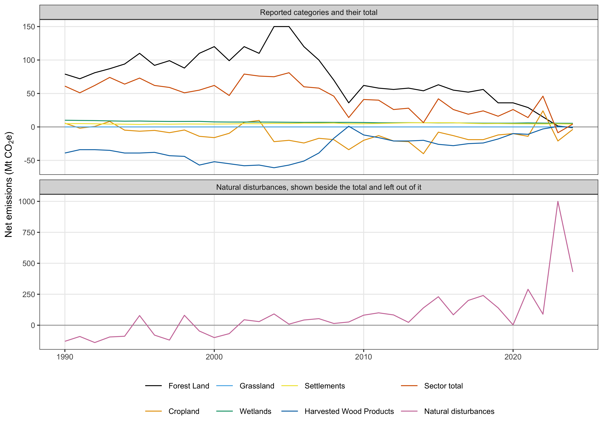
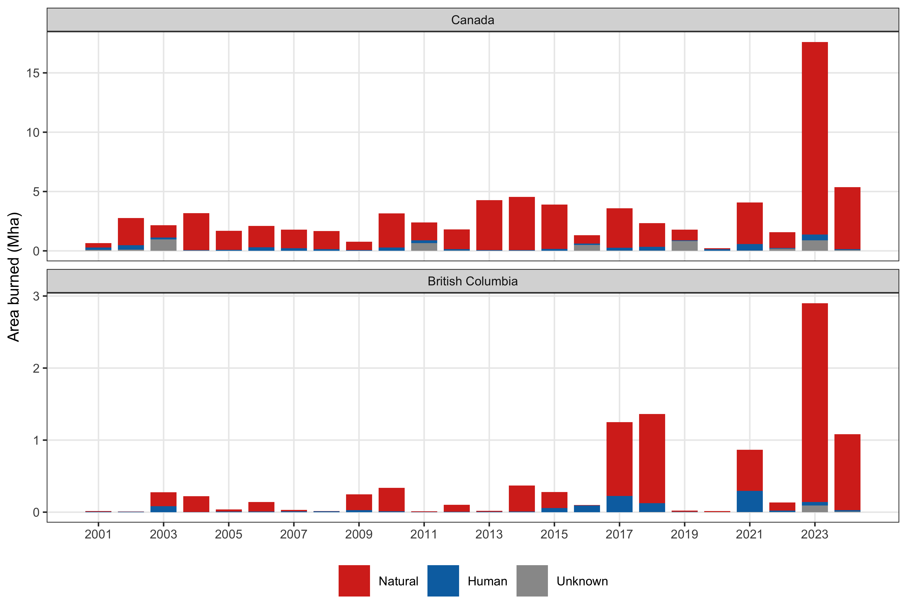
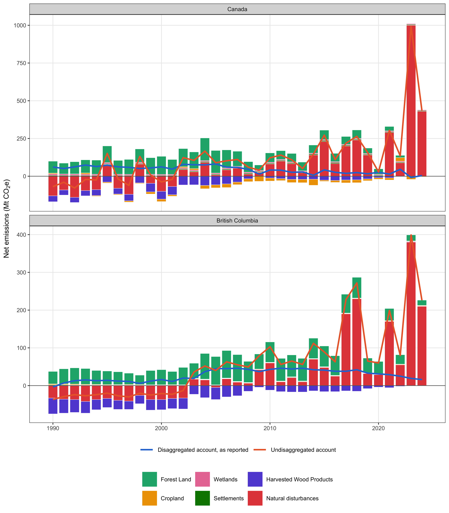

```{r}
#| label: or-setup
fmt_tbl <- function(df, right = NULL) {
  right <- union(names(df)[vapply(df, is.numeric, TRUE)], right)
  flextable::flextable(df) |>
    flextable::fontsize(size = 9, part = "all") |>
    flextable::align(align = "center", part = "header") |>
    flextable::align(j = setdiff(names(df), right), align = "left", part = "body") |>
    flextable::align(j = right, align = "right", part = "body") |>
    flextable::colformat_int(big.mark = "") |>
    flextable::padding(padding.top = 1, padding.bottom = 1, part = "all") |>
    flextable::set_table_properties(layout = "autofit", width = 1)
}
read_tbl <- function(f) readr::read_csv(file.path("../03.outputs/TBL", f), show_col_types = FALSE, col_types = readr::cols(.default = "c"))
```

Online Resources for the article submitted to Climatic Change. Each item is cited in the article by its number. The code that produced every table and figure is in the article's source file in the repository named in the Data availability statement.

**Online Resource 1** Net emissions of Canada's land use sector by category, 1990 to 2024, from Table 6-1 of the 2026 National Inventory Report. The lower panel is the natural disturbance line the table shows beside the total but leaves out of it.



**Online Resource 2** Tier 1 defaults of the 2006 Guidelines matched to Canada's ecological zones. The zone and its code follow Table 4.1 of Chapter 4, and the area is the zone's extent within Canada. Fuel burned is the product of fuel load and combustion factor in Table 2.4, mean and standard error. The combustion factor is from Table 2.6, mean and standard deviation. Table 2.6 gives no wildfire value for other temperate forests or for grassland, so the values of all other temperate forests and of all savanna grasslands are shown. The emission factors are the Table 2.5 row named, mean and standard deviation. Tundra has no printed error and no combustion factor.

```{r}
fmt_tbl(read_tbl("tbl-defaults.csv"))
```

**Online Resource 3** Net emissions, crediting level and emission reduction for British Columbia under three accounts, 2017 to 2024, on a 2012 to 2016 reference period, from the provincial lines of the national inventory. The burned area share is the province's share of the area burned in Canada. The threshold account leaves out the natural disturbance line only in years that pass both the national and the provincial test.

```{r}
fmt_tbl(read_tbl("tbl-bc.csv"))
```

**Online Resource 4** Fuel consumption and emission factors behind the FAOSTAT fire values for Canada, 2001 to 2024, recovered by division. Fuel is biomass burned divided by burned area, the product of fuel load and combustion factor listed in Table 2.4 of the 2006 Guidelines, named by the row it equals. Each emission factor is the gas emitted divided by biomass burned. Every item's factors equal the savanna and grassland row of Table 2.5, whose extra tropical forest row is given last for comparison. FAO publishes no carbon dioxide for the savanna, grassland and shrubland items.

```{r}
fmt_tbl(read_tbl("tbl-coefficients.csv"))
```

**Online Resource 5** Area burned in Canada and British Columbia by year and recorded cause, 2001 to 2024, from the fire points of the Canadian National Fire Database. Natural, human and unknown are the database's cause codes.



**Online Resource 6** Net emissions of the land use sector for Canada and British Columbia, 1990 to 2024, under two accounts. The disaggregated account is the total Canada reports, and the undisaggregated account is that total plus the natural disturbance line.



**Online Resource 7** Each term of the Tier 1 fire estimate as the global default supplied it and as the national datasets supply it. The national datasets are the 2026 Fire Behaviour Prediction fuel types and the peatland map of the Canadian Forest Service. The burned areas are from the National Burned Area Composite and the fire points of the Canadian National Fire Database, and the emission factors and natural share from the inventory's own method. Areas are counted on the 2 km grid of Fig. 1 of the article.

```{r}
fmt_tbl(read_tbl("tbl-tier2.csv"))
```

**Online Resource 8** The emission reduction of each account from 10,000 Monte Carlo draws with the published model interval on every annual value. The mean and standard deviation are those of the draws, and the 5th and 95th percentiles bound the 90 per cent interval. The relative half width is half the distance between those percentiles over the mean, the 90 per cent confidence interval of Equation 11, and the adjustment factor is that half width times 0.524417 over 1.645006, the share of the reduction withheld. Both are printed only where the mean reduction is positive.

```{r}
fmt_tbl(read_tbl("tbl-uncertainty.csv"))
```
