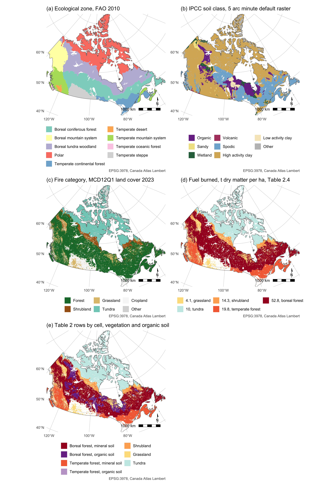
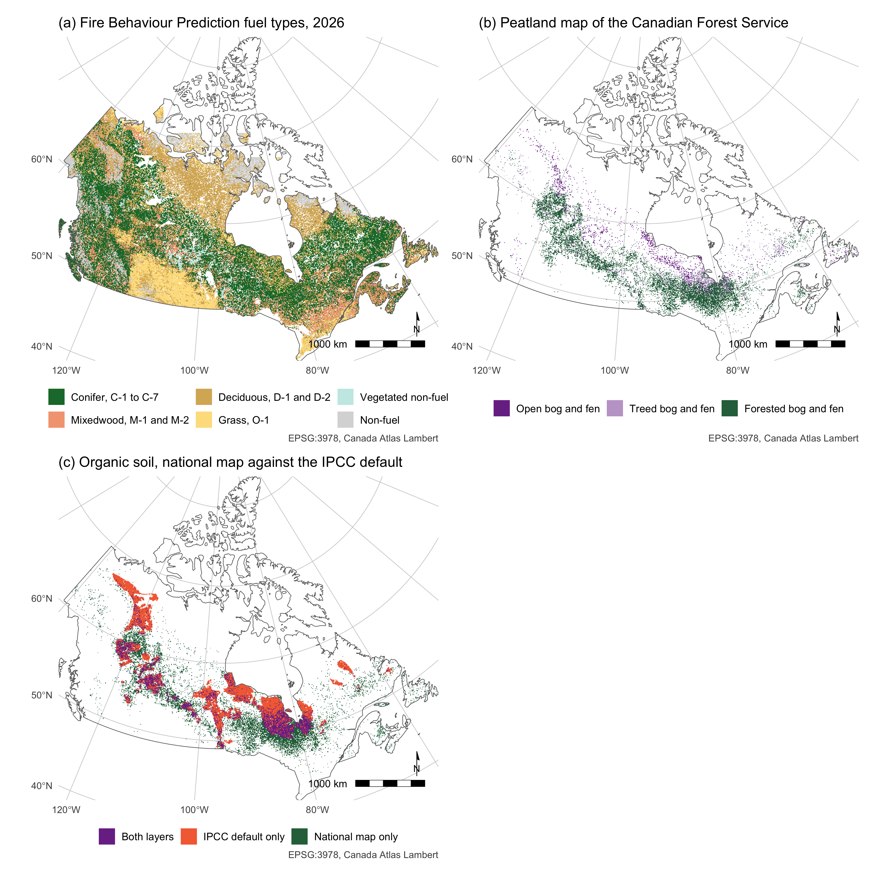

# Reported emissions and removals from Canada's managed forest with and without the disaggregation of natural disturbances

*Uncertainty deductions under the ART TREES standard and the IPCC Tier 1 forest fire emissions estimate*

## Abstract

Canada reported its managed forest with natural disturbance disaggregated from human activity, as cited in the 2019 Refinement to the guidelines of the Intergovernmental Panel on Climate Change. Whether it decided a country’s credit had not been tested. This study ran Canada’s 2026 inventory through ART TREES, the standard of the Architecture for REDD+ Transactions, for 2017 to 2024, with and without the disaggregation. A third, threshold account excluded natural disturbance only in fire years two standard deviations above a baseline mean. With the disaggregation, Canada showed reductions in 6 of 8 crediting years, totalling 85.6 million tonnes of carbon dioxide equivalent. Without it, emissions exceeded the crediting level by 853.6 million tonnes in 2023. The threshold rule gave Canada 396.2 million tonnes, 4.6 times its reported account, because ordinary reference years raised the crediting level. The disaggregated account stayed uncertain by more than its own size, with deductions of 51.8 to 1,176.9 per cent. Every positive year kept a credit only when more than 99.6 per cent of the model error was shared between years. The fire emissions the Food and Agriculture Organization published for Canada were reproduced from its stated method within 1 per cent. Crediting standards relying on the disaggregation therefore needed a stated record length and regrowth period. They also needed to exclude only an extreme fire year’s emissions above those of an ordinary year. The uncertainty deduction had to be taken on gross emissions and removals rather than on a net near zero.

*Fig. 1 Canada’s strata for the Tier 1 fire estimate, five maps on one scale in EPSG:3978. (a) The ecological zones of Table 4.1 of the 2006 Guidelines, FAO 2010. (b) The IPCC default soil classes at 5 arc minutes. (c) The fire category from the MCD12Q1 land cover of 2023, forest for IGBP classes 1 to 5, 8 and 9, shrubland for 6 and 7, grassland for 10 and 11, open polar land as tundra. (d) The fuel burned per hectare of Table 2.4 by zone and category. (e) The rows of Table 1 that overlap on each cell. Map lines delineate study areas and do not necessarily depict accepted national boundaries.*

*Table 1 Rows of Tables 2.4 and 2.6 of the 2006 Guidelines for Canada’s vegetation, fuel burned as mean and standard error, combustion factor as mean and standard deviation, and the Table 2.5 row of their emission factors, with the organic soil rows of the 2013 Wetlands Supplement, mean and 95 per cent interval, whose Table 2.7 gave 362 ± 41 g of carbon dioxide carbon and 9 ± 4 g of methane per kilogram. A blank is a value the table did not print.*

<table>
<thead>
<tr>
<th width="2000" align="left">Vegetation</th>
<th width="2000" align="left">Subcategory</th>
<th width="2000" align="left">Fuel burned (t/ha)</th>
<th width="2000" align="left">Combustion factor</th>
<th width="2000" align="left">Emission factor row</th>
</tr>
</thead>
<tbody>
<tr><td align="left">Boreal forest</td><td align="left">Wildfire (general)</td><td align="left">52.8 ± 48.4</td><td align="left">0.40 ± 0.06</td><td align="left">Extra tropical forest</td></tr>
<tr><td align="left">Boreal forest</td><td align="left">Crown fire</td><td align="left">25.1 ± 7.9</td><td align="left">0.43 ± 0.21</td><td align="left">Extra tropical forest</td></tr>
<tr><td align="left">Boreal forest</td><td align="left">Surface fire</td><td align="left">21.6 ± 25.1</td><td align="left">0.15 ± 0.08</td><td align="left">Extra tropical forest</td></tr>
<tr><td align="left">Boreal forest</td><td align="left">Post logging slash burn</td><td align="left">69.6 ± 44.8</td><td align="left">0.33 ± 0.13</td><td align="left">Extra tropical forest</td></tr>
<tr><td align="left">Boreal forest</td><td align="left">Land clearing fire</td><td align="left">87.5 ± 35.0</td><td align="left">0.59</td><td align="left">Extra tropical forest</td></tr>
<tr><td align="left">Boreal forest</td><td align="left">All boreal forest</td><td align="left">41.0 ± 36.5</td><td align="left">0.34 ± 0.17</td><td align="left">Extra tropical forest</td></tr>
<tr><td align="left">Other temperate forests</td><td align="left">Wildfire</td><td align="left">19.8 ± 6.3</td><td align="left"></td><td align="left">Extra tropical forest</td></tr>
<tr><td align="left">Other temperate forests</td><td align="left">Post logging slash burn</td><td align="left">77.5 ± 65.0</td><td align="left">0.62 ± 0.12</td><td align="left">Extra tropical forest</td></tr>
<tr><td align="left">Other temperate forests</td><td align="left">Felled and burned (land clearing fire)</td><td align="left">48.4 ± 62.7</td><td align="left">0.51</td><td align="left">Extra tropical forest</td></tr>
<tr><td align="left">Other temperate forests</td><td align="left">All other temperate forests</td><td align="left">50.4 ± 53.7</td><td align="left">0.45 ± 0.16</td><td align="left">Extra tropical forest</td></tr>
<tr><td align="left">Shrublands</td><td align="left">Shrubland (general)</td><td align="left">26.7 ± 4.2</td><td align="left">0.95</td><td align="left">Savanna and grassland</td></tr>
<tr><td align="left">Shrublands</td><td align="left">All shrublands</td><td align="left">14.3 ± 9.0</td><td align="left">0.72 ± 0.25</td><td align="left">Savanna and grassland</td></tr>
<tr><td align="left">Savanna grasslands and pastures</td><td align="left">All savanna grasslands (early dry season burns)</td><td align="left">2.1</td><td align="left">0.74</td><td align="left">Savanna and grassland</td></tr>
<tr><td align="left">Savanna grasslands and pastures</td><td align="left">Grassland (mid or late dry season burns)</td><td align="left">4.1 ± 3.1</td><td align="left">0.77 ± 0.26</td><td align="left">Savanna and grassland</td></tr>
<tr><td align="left">Other vegetation types</td><td align="left">Peatland</td><td align="left">41.0 ± 1.4</td><td align="left"></td><td align="left"></td></tr>
<tr><td align="left">Other vegetation types</td><td align="left">Tundra</td><td align="left">10.0</td><td align="left"></td><td align="left">Savanna and grassland</td></tr>
<tr><td align="left">Organic soil, boreal and temperate</td><td align="left">Wildfire (undrained peat)</td><td align="left">66 (46 to 86)</td><td align="left">1</td><td align="left">Wetlands Supplement Table 2.7</td></tr>
<tr><td align="left">Organic soil, boreal and temperate</td><td align="left">Wildfire (drained peat)</td><td align="left">336 ± 4</td><td align="left">1</td><td align="left">Wetlands Supplement Table 2.7</td></tr>
</tbody>
</table>

*Fig. 2 The national layers beside the Tier 1 defaults, on the scale of Fig. 1. (a) The Fire Behaviour Prediction fuel types, 2026 release, grouped by fuel. (b) The peatland map of the Canadian Forest Service, bog and fen by canopy. (c) Where that map and the IPCC default soil raster agree on organic soil. Map lines delineate study areas and do not necessarily depict accepted national boundaries.*

*Table 2 Net emissions, crediting level and emission reduction for Canada’s managed land under three accounts, 2017 to 2024. The crediting level is the mean of 2012 to 2016, Equation 1 of ART TREES, and the reduction is the level minus the year’s net emissions, Equation 12. The threshold account leaves out the natural disturbance line only in years the 13 year baseline classes as natural. A negative reduction is a reversal.*

<table>
<thead>
<tr>
<th width="2000" align="left">Year</th>
<th width="2000" align="left">Account</th>
<th width="2000" align="left">Net emissions (Mt CO2e)</th>
<th width="2000" align="left">Crediting level (Mt CO2e)</th>
<th width="2000" align="left">Emission reduction (Mt CO2e)</th>
</tr>
</thead>
<tbody>
<tr><td align="left">2017</td><td align="left">Disaggregated</td><td align="left">19.0</td><td align="left">25.7</td><td align="left">6.7</td></tr>
<tr><td align="left">2017</td><td align="left">Undisaggregated</td><td align="left">219.0</td><td align="left">137.7</td><td align="left">-81.3</td></tr>
<tr><td align="left">2017</td><td align="left">Threshold</td><td align="left">219.0</td><td align="left">91.7</td><td align="left">-127.3</td></tr>
<tr><td align="left">2018</td><td align="left">Disaggregated</td><td align="left">24.0</td><td align="left">25.7</td><td align="left">1.7</td></tr>
<tr><td align="left">2018</td><td align="left">Undisaggregated</td><td align="left">264.0</td><td align="left">137.7</td><td align="left">-126.3</td></tr>
<tr><td align="left">2018</td><td align="left">Threshold</td><td align="left">24.0</td><td align="left">91.7</td><td align="left">67.7</td></tr>
<tr><td align="left">2019</td><td align="left">Disaggregated</td><td align="left">16.0</td><td align="left">25.7</td><td align="left">9.7</td></tr>
<tr><td align="left">2019</td><td align="left">Undisaggregated</td><td align="left">156.0</td><td align="left">137.7</td><td align="left">-18.3</td></tr>
<tr><td align="left">2019</td><td align="left">Threshold</td><td align="left">156.0</td><td align="left">91.7</td><td align="left">-64.3</td></tr>
<tr><td align="left">2020</td><td align="left">Disaggregated</td><td align="left">26.0</td><td align="left">25.7</td><td align="left">-0.3</td></tr>
<tr><td align="left">2020</td><td align="left">Undisaggregated</td><td align="left">28.7</td><td align="left">137.7</td><td align="left">109.0</td></tr>
<tr><td align="left">2020</td><td align="left">Threshold</td><td align="left">28.7</td><td align="left">91.7</td><td align="left">63.0</td></tr>
<tr><td align="left">2021</td><td align="left">Disaggregated</td><td align="left">14.0</td><td align="left">25.7</td><td align="left">11.7</td></tr>
<tr><td align="left">2021</td><td align="left">Undisaggregated</td><td align="left">304.0</td><td align="left">137.7</td><td align="left">-166.3</td></tr>
<tr><td align="left">2021</td><td align="left">Threshold</td><td align="left">14.0</td><td align="left">91.7</td><td align="left">77.7</td></tr>
<tr><td align="left">2022</td><td align="left">Disaggregated</td><td align="left">46.0</td><td align="left">25.7</td><td align="left">-20.3</td></tr>
<tr><td align="left">2022</td><td align="left">Undisaggregated</td><td align="left">135.0</td><td align="left">137.7</td><td align="left">2.7</td></tr>
<tr><td align="left">2022</td><td align="left">Threshold</td><td align="left">135.0</td><td align="left">91.7</td><td align="left">-43.3</td></tr>
<tr><td align="left">2023</td><td align="left">Disaggregated</td><td align="left">-8.7</td><td align="left">25.7</td><td align="left">34.4</td></tr>
<tr><td align="left">2023</td><td align="left">Undisaggregated</td><td align="left">991.3</td><td align="left">137.7</td><td align="left">-853.6</td></tr>
<tr><td align="left">2023</td><td align="left">Threshold</td><td align="left">-8.7</td><td align="left">91.7</td><td align="left">100.4</td></tr>
<tr><td align="left">2024</td><td align="left">Disaggregated</td><td align="left">4.3</td><td align="left">25.7</td><td align="left">21.4</td></tr>
<tr><td align="left">2024</td><td align="left">Undisaggregated</td><td align="left">434.3</td><td align="left">137.7</td><td align="left">-296.6</td></tr>
<tr><td align="left">2024</td><td align="left">Threshold</td><td align="left">4.3</td><td align="left">91.7</td><td align="left">87.4</td></tr>
</tbody>
</table>

*Table 3 The Tier 1 fire estimate for Canada by ecological zone from the fire points, 2023, with each zone’s burned area averaged over 2001 to 2024. Fuel burned and the emission factors are the zone’s rows in Online Resource 2. The uncertainty is the Approach 1 half width of the 95 per cent interval for carbon dioxide, with no error on burned area. The last row is FAO’s published value.*

<table>
<thead>
<tr>
<th width="2000" align="left">Ecological zone</th>
<th width="2000" align="left">Burned 2001 to 2024 (kha a year)</th>
<th width="2000" align="left">Burned 2023 (kha)</th>
<th width="2000" align="left">Fuel burned (t/ha)</th>
<th width="2000" align="left">CO2 (Mt)</th>
<th width="2000" align="left">CH4 (kt)</th>
<th width="2000" align="left">N2O (kt)</th>
<th width="2000" align="left">CO2e (Mt)</th>
<th width="2000" align="left">Uncertainty (%)</th>
</tr>
</thead>
<tbody>
<tr><td align="left">Boreal tundra woodland</td><td align="left">1355</td><td align="left">10967</td><td align="left">52.8</td><td align="left">908.6</td><td align="left">2722</td><td align="left">150.6</td><td align="left">1024.7</td><td align="left">180</td></tr>
<tr><td align="left">Boreal coniferous forest</td><td align="left">1226</td><td align="left">4912</td><td align="left">52.8</td><td align="left">407.0</td><td align="left">1219</td><td align="left">67.4</td><td align="left">459.0</td><td align="left">180</td></tr>
<tr><td align="left">Temperate mountain system</td><td align="left">199</td><td align="left">744</td><td align="left">19.8</td><td align="left">23.1</td><td align="left">69</td><td align="left">3.8</td><td align="left">26.0</td><td align="left">64</td></tr>
<tr><td align="left">Boreal mountain system</td><td align="left">249</td><td align="left">634</td><td align="left">52.8</td><td align="left">52.5</td><td align="left">157</td><td align="left">8.7</td><td align="left">59.2</td><td align="left">180</td></tr>
<tr><td align="left">Temperate desert</td><td align="left">46</td><td align="left">179</td><td align="left">4.1</td><td align="left">1.2</td><td align="left">2</td><td align="left">0.2</td><td align="left">1.3</td><td align="left">149</td></tr>
<tr><td align="left">Temperate continental forest</td><td align="left">25</td><td align="left">81</td><td align="left">19.8</td><td align="left">2.5</td><td align="left">8</td><td align="left">0.4</td><td align="left">2.8</td><td align="left">64</td></tr>
<tr><td align="left">Polar</td><td align="left">6</td><td align="left">68</td><td align="left">10.0</td><td align="left">1.1</td><td align="left">2</td><td align="left">0.1</td><td align="left">1.2</td><td align="left"></td></tr>
<tr><td align="left">Temperate steppe</td><td align="left">5</td><td align="left">15</td><td align="left">4.1</td><td align="left">0.1</td><td align="left">0</td><td align="left">0.0</td><td align="left">0.1</td><td align="left">149</td></tr>
<tr><td align="left">Temperate oceanic forest</td><td align="left">0</td><td align="left">4</td><td align="left">19.8</td><td align="left">0.1</td><td align="left">0</td><td align="left">0.0</td><td align="left">0.1</td><td align="left">64</td></tr>
<tr><td align="left">All zones</td><td align="left">3112</td><td align="left">17604</td><td align="left">50.5</td><td align="left">1396.2</td><td align="left">4179</td><td align="left">231.3</td><td align="left">1574.5</td><td align="left">177</td></tr>
<tr><td align="left">FAOSTAT, other forest, one coefficient</td><td align="left">340</td><td align="left">2750</td><td align="left">42.2</td><td align="left">187.0</td><td align="left">267</td><td align="left">24.3</td><td align="left">200.9</td><td align="left">175</td></tr>
</tbody>
</table>

*Table 4 The Tier 1 fire estimate for 2023 by stratum, for Canada and for British Columbia (BC), from the fire points. Each fire took the row of Table 1 for its ecological zone and fire type, and every fire on organic soil the undrained peat row of the Wetlands Supplement as a second term. Ignition, fire type and month are the record’s own fields; the soil class and the land cover are the raster values at the fire’s location.*

<table>
<thead>
<tr>
<th width="2000" align="left">Stratum</th>
<th width="2000" align="left">Class</th>
<th width="2000" align="left">Canada burned (kha)</th>
<th width="2000" align="left">Canada vegetation CO2e (Mt)</th>
<th width="2000" align="left">Canada organic soil CO2e (Mt)</th>
<th width="2000" align="left">BC burned (kha)</th>
<th width="2000" align="left">BC vegetation CO2e (Mt)</th>
<th width="2000" align="left">BC organic soil CO2e (Mt)</th>
</tr>
</thead>
<tbody>
<tr><td align="left">Ignition</td><td align="left">Natural</td><td align="left">16220</td><td align="left">1372.2</td><td align="left">457.4</td><td align="left">2758</td><td align="left">203.0</td><td align="left">103.6</td></tr>
<tr><td align="left"></td><td align="left">Unknown</td><td align="left">888</td><td align="left">56.5</td><td align="left">32.2</td><td align="left">93</td><td align="left">6.5</td><td align="left">0.2</td></tr>
<tr><td align="left"></td><td align="left">Human</td><td align="left">496</td><td align="left">39.9</td><td align="left">0.5</td><td align="left">49</td><td align="left">3.8</td><td align="left">0.0</td></tr>
<tr><td align="left">Fire type</td><td align="left">Unspecified</td><td align="left">15523</td><td align="left">1380.0</td><td align="left">403.4</td><td align="left">2899</td><td align="left">213.2</td><td align="left">103.8</td></tr>
<tr><td align="left"></td><td align="left">Surface</td><td align="left">1028</td><td align="left">39.3</td><td align="left">52.7</td><td align="left">0</td><td align="left">0.0</td><td align="left">0.0</td></tr>
<tr><td align="left"></td><td align="left">Crown</td><td align="left">1000</td><td align="left">44.4</td><td align="left">33.0</td><td align="left">0</td><td align="left">0.0</td><td align="left">0.0</td></tr>
<tr><td align="left"></td><td align="left">Ground</td><td align="left">53</td><td align="left">5.0</td><td align="left">1.1</td><td align="left">0</td><td align="left">0.0</td><td align="left">0.0</td></tr>
<tr><td align="left"></td><td align="left">Prescribed</td><td align="left">0</td><td align="left">0.0</td><td align="left">0.0</td><td align="left">0</td><td align="left">0.0</td><td align="left">0.0</td></tr>
<tr><td align="left">Month</td><td align="left">April to May</td><td align="left">6545</td><td align="left">529.9</td><td align="left">195.4</td><td align="left">1040</td><td align="left">96.6</td><td align="left">30.2</td></tr>
<tr><td align="left"></td><td align="left">July</td><td align="left">5016</td><td align="left">414.7</td><td align="left">166.4</td><td align="left">1086</td><td align="left">61.7</td><td align="left">35.9</td></tr>
<tr><td align="left"></td><td align="left">June</td><td align="left">4793</td><td align="left">412.6</td><td align="left">67.5</td><td align="left">631</td><td align="left">45.5</td><td align="left">30.2</td></tr>
<tr><td align="left"></td><td align="left">August to October</td><td align="left">1248</td><td align="left">111.2</td><td align="left">60.8</td><td align="left">142</td><td align="left">9.3</td><td align="left">7.5</td></tr>
<tr><td align="left"></td><td align="left">Other months</td><td align="left">2</td><td align="left">0.2</td><td align="left">0.1</td><td align="left">0</td><td align="left">0.0</td><td align="left">0.0</td></tr>
<tr><td align="left">Soil class</td><td align="left">Mineral</td><td align="left">12496</td><td align="left">1035.3</td><td align="left">0.0</td><td align="left">1895</td><td align="left">119.6</td><td align="left">0.0</td></tr>
<tr><td align="left"></td><td align="left">Organic</td><td align="left">4702</td><td align="left">395.9</td><td align="left">490.1</td><td align="left">996</td><td align="left">93.0</td><td align="left">103.8</td></tr>
<tr><td align="left"></td><td align="left">Other</td><td align="left">406</td><td align="left">37.5</td><td align="left">0.0</td><td align="left">9</td><td align="left">0.6</td><td align="left">0.0</td></tr>
<tr><td align="left">Land cover</td><td align="left">Woody savanna, IGBP 8</td><td align="left">8605</td><td align="left">688.0</td><td align="left">330.3</td><td align="left">1367</td><td align="left">99.0</td><td align="left">77.8</td></tr>
<tr><td align="left"></td><td align="left">Savanna, IGBP 9</td><td align="left">5241</td><td align="left">487.6</td><td align="left">117.3</td><td align="left">1</td><td align="left">0.1</td><td align="left">0.0</td></tr>
<tr><td align="left"></td><td align="left">Forest, IGBP 1 to 5</td><td align="left">2704</td><td align="left">205.4</td><td align="left">42.2</td><td align="left">1458</td><td align="left">112.9</td><td align="left">26.0</td></tr>
<tr><td align="left"></td><td align="left">Shrubland, IGBP 6 to 7</td><td align="left">506</td><td align="left">43.5</td><td align="left">0.1</td><td align="left">0</td><td align="left">0.0</td><td align="left">0.0</td></tr>
<tr><td align="left"></td><td align="left">Other</td><td align="left">334</td><td align="left">29.6</td><td align="left">0.0</td><td align="left">8</td><td align="left">0.5</td><td align="left">0.0</td></tr>
<tr><td align="left"></td><td align="left">Wetland, IGBP 11</td><td align="left">140</td><td align="left">13.1</td><td align="left">0.2</td><td align="left">0</td><td align="left">0.0</td><td align="left">0.0</td></tr>
<tr><td align="left"></td><td align="left">Grassland, IGBP 10</td><td align="left">73</td><td align="left">1.5</td><td align="left">0.0</td><td align="left">65</td><td align="left">0.8</td><td align="left">0.0</td></tr>
<tr><td align="left">All fires</td><td align="left"></td><td align="left">17604</td><td align="left">1468.6</td><td align="left">490.1</td><td align="left">2899</td><td align="left">213.2</td><td align="left">103.8</td></tr>
</tbody>
</table>
