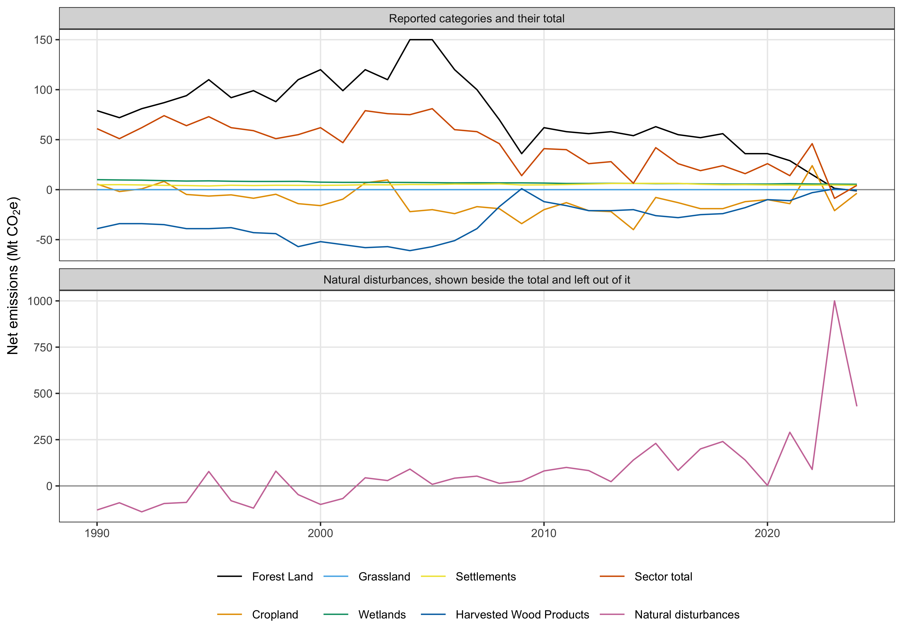
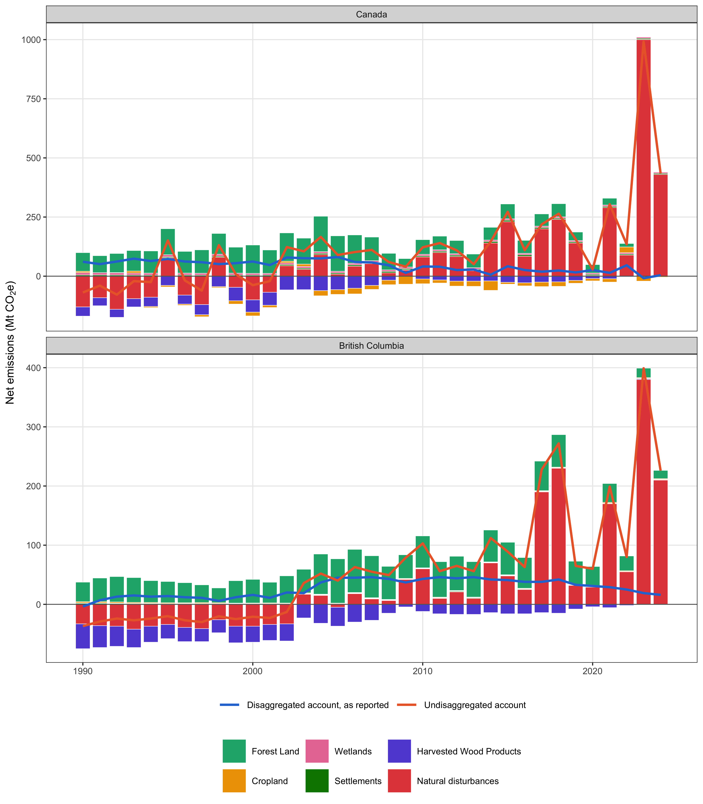

# ipcc-uncertainties

This repository holds a manuscript in development on disaggregating natural disturbance from human activity in Canada's forest carbon inventory, as the 2019 Refinement to the IPCC guidelines allows, and on what that disaggregation does to the credit a country or province can claim under ART TREES. It compares the account Canada reports with the same land undisaggregated and with a third account built under Australia's natural disturbance rule, and it checks whether the FAOSTAT fire emissions for Canada can be rebuilt from FAOSTAT's own method. The whole analysis is one Quarto document, `01.manuscript/Manuscript.qmd`, and rendering it with R reproduces every number, table and figure the paper reports.

## Hard rules

These rules were set by Seamus Murphy on 17 September 2026 in these words, "only code that is present inside the manuscript.qmd is considered in the analysis, any code left outside in helper scripts or anywhere are disregarded, and as a result we rely only report calculcation estimates from the runtime by R of the full manuscript markdown."

1. Only code inside `01.manuscript/Manuscript.qmd` is part of the study. A script anywhere else in this repository, or on any machine, is disregarded, and an output it produced is not evidence and is not cited.
2. Every estimate the paper reports is computed by R while the full manuscript renders, and is written into the prose as an inline `r` expression or printed by a chunk. No number is typed by hand.
3. Every chunk is R, shows its code with `echo: true` and runs with `eval: true`. No chunk calls `source()`, reads chunks from another file, includes another document, shells out with `system()` or reads from `05.tasks/`. The pre-render guard `01.manuscript/_tools/check-manuscript-code.py` checks all of this and stops the render on any breach.
4. A step that is slow or fetches data runs inside a guarded chunk, which writes its output to `02.inputs/` or `03.outputs/` and rebuilds that output only when the file is missing. Deleting the output and rendering again reproduces it from the same code and the same seed.
5. Every line that reads a third-party dataset carries, in the comment lines directly above it, the dataset's name and the link it was retrieved from, the DOI as an https link where one exists. The same entry is recorded in `02.inputs/README.md`.
6. The scripts in `01.manuscript/_tools/` format the Word file, count its words and rebuild the results block of this README. None of them computes anything the paper reports.
7. `05.tasks/` holds correspondence and working notes only. Nothing is read from it or written to it by a render, and it is not in git.

A guarded chunk that fetches a dataset takes this form.

```r
#| label: fetch-example
#| echo: true
#| output: false

# <Dataset name as the publisher gives it>
# <https link or DOI the file was retrieved from>
if (!file.exists("02.inputs/example/raw/example.csv")) {
  dir.create("02.inputs/example/raw", recursive = TRUE)
  download.file("<https link>", "02.inputs/example/raw/example.csv", mode = "wb")
}
example <- readr::read_csv("02.inputs/example/raw/example.csv")
```

## Repository layout

| Path | Contents |
|---|---|
| `01.manuscript/Manuscript.qmd` | The manuscript and the entire analysis |
| `01.manuscript/_tools/` | Render hooks that check the manuscript, format the Word file and rebuild this README |
| `02.inputs/` | Input data, with the provenance of every source in `02.inputs/README.md` |
| `03.outputs/PNG/` | Figures written by the render at 300 dpi |
| `03.outputs/TBL/` | Tables written by the render as CSV |
| `04.references/` | `references.bib`, the citation style, the Word reference document and the HTML stylesheet |
| `04.references/literature/` | Saved PDFs of cited work, kept out of git |
| `05.tasks/` | Correspondence and working notes, kept out of git |

## Rendering

Render from the repository root with a bare command, so that both formats are produced, Word first.

```bash
quarto render
```

The Word copy for submission is rendered with the code hidden, `quarto render --to docx -M echo:false`, while the HTML keeps every chunk visible. The README block below is built from the HTML, so render that format after a change to the prose or captions.

Quarto runs the steps in this order.

1. `clean-appledouble.py` deletes the `._` files the exFAT drive writes beside every file.
2. `check-manuscript-code.py` stops the render if the manuscript depends on code it does not contain.
3. R renders `Manuscript.qmd` to `Manuscript.docx` and `Manuscript.html`, with every chunk run from the repository root.
4. `format-tables.py` sets every Word table to 16.5 cm wide and 8 pt, shares the columns in proportion to the widest cell each must hold on one line, sets body rows to 0.6 cm and the header to the lines it needs, and gives any table wider than 16.5 cm its own landscape page with the page numbers running on.
5. `stamp-wordcounts.py` counts the Word file, fills the word count paragraph and reports the counts.
6. `build-readme.py` replaces the block between the render markers below with the title, the abstract, a list of every figure and table with the section it sits in, and the figures and tables themselves.

The hooks need Python 3.12 with `lxml`. The manuscript needs R 4.4 with `knitr`, `rmarkdown`, `flextable` and `ggplot2`, read from the global user library.

## Tables and figures

Every table is a chunk labelled `tbl-` with its caption in `#| tbl-cap:`, printed through `fmt_tbl()` from the setup chunk, which centres the header, right-aligns numeric columns and left-aligns text. Every figure is a chunk labelled `fig-` with its caption in `#| fig-cap:`, drawn with `ggplot2` on the setup theme `th` and written to `03.outputs/PNG/` at 300 dpi. The prose refers to each as `@tbl-name` or `@fig-name`, so Quarto numbers them and no caption types its own number. A table the manuscript reports is also written to `03.outputs/TBL/` as CSV by the chunk that builds it.

Significance in a table is marked beside the estimate, `*` for p ≤ 0.05, `**` for p ≤ 0.01, `***` for p ≤ 0.001 and `****` for p ≤ 0.0001, with the legend in the caption. Exact p-values, with a floor of p < 0.001, belong in the prose.

## References

`04.references/references.bib` holds one entry per cited work. Each journal article is taken from its CrossRef record rather than typed, and a report or chapter without a DOI is taken from its own title page. Citations print in APA style from `apa.csl` until a target journal is chosen, when its own style replaces it after its current guide for authors has been read.

## Git rules

Raw third-party data, saved PDFs, `05.tasks/`, the Claude Code state in `.claude/` and `CLAUDE.md`, and every Quarto and knitr intermediate are ignored, because this repository is public and GitHub rejects any file over 100 MB. The manuscript source, the render hooks, the bibliography, the style files, the rendered `Manuscript.docx` and `Manuscript.html`, and the derived figures and tables are committed. Commit subjects are plain imperative sentences that give the reason for the change.

## Traps

A bracketed citation placed directly after a cross-reference is swallowed and never prints, because pandoc reads the bracket as the suffix of the reference beside it. Writing `@fig-test [@kurz2024revised]` gives "Figure 1" and no citation, and the render reports nothing. A comma between the two, `@fig-test, [@kurz2024revised]`, prints both. Every citation is therefore read back out of the render rather than trusted from the source.

## Current render

<!-- render:start -->

## Reported emissions and removals from Canada's managed forest with disaggregation of natural disturbances


Everything from here to the end marker is generated from the render by `01.manuscript/_tools/build-readme.py`. Do not edit it by hand.

### Abstract

Canada reported its managed forest with natural disturbance disaggregated from human activity, as cited in the 2019 Refinement to the guidelines of the Intergovernmental Panel on Climate Change. Whether that disaggregation decided the credit a country or province could claim had not been tested. This study ran Canada’s 2026 inventory (1990 to 2024) through ART TREES, the standard of the Architecture for REDD+ Transactions, for 2017 to 2024, with and without the disaggregation. A third account followed Australia’s rule, which left natural disturbance out only in a fire year above a baseline threshold. With the disaggregation, Canada showed reductions in 6 of 8 crediting years, totalling 85.6 million tonnes of carbon dioxide equivalent. Without it, reductions appeared in 2 years and emissions exceeded the crediting level by 853.6 million tonnes in 2023 alone. British Columbia showed 104.6 million tonnes with the disaggregation and exceeded its level by 322 million tonnes without it. Australia’s rule gave Canada 396.2 million tonnes, 4.6 times its reported account, because the fires of ordinary years kept in the reference period raised the crediting level. The disaggregated account stayed uncertain by more than its own size, with uncertainty deductions of 51.8 to 1,176.9 per cent. Nothing was left to issue once the reported uncertainty reached 235 per cent. FAOSTAT’s fire emissions for Canada applied savanna and grassland emission factors and reported no carbon dioxide for the 86 per cent of burned area it classed as savanna, grassland or shrubland. Crediting standards that relied on the disaggregation therefore needed a stated record length, a stated regrowth period and an exclusion limited to the emissions above the ordinary level. They also needed an uncertainty deduction on gross emissions and removals rather than a net near zero.

### Figures and tables

The render holds 2 figures and 4 tables, listed here in document order with the section each sits in.

- Figure 1, in section 2.3 Canadian inventory. Net emissions of Canada’s land use sector by category, 1990 to 2024, from Table 6-1 of the 2026 inventory.
- Figure 2, in section 3.1 Reported national emissions. Net emissions of the land use sector for Canada and British Columbia, 1990 to 2024, under two accounts.
- Table 1, in section 3.3 Crediting Canada. Emissions and reductions for Canada’s managed land under three accounts, 2017 to 2024, on a 2012 to 2016 reference period.
- Table 2, in section 3.4 Crediting British Columbia. Emissions and reductions for British Columbia under three accounts, 2017 to 2024, on a 2012 to 2016 reference period, from the provincial lines of the national inventory.
- Table 3, in section 3.5 Account uncertainty. Reductions and their uncertainty for Canada under the three accounts, from 10,000 Monte Carlo draws.
- Table 4, in section 3.8 FAOSTAT’s coefficients. Fuel consumption and emission factors FAOSTAT applied to fires in Canada, 2001 to 2024, recovered from its published values.

### Results

Every figure and table below is reproduced from the current render, in the order it appears in the manuscript.

#### Figure 1



*Net emissions of Canada’s land use sector by category, 1990 to 2024, from Table 6-1 of the 2026 inventory. The lower panel is the natural disturbance line the table shows beside the total but leaves out of it.*

#### Figure 2



*Net emissions of the land use sector for Canada and British Columbia, 1990 to 2024, under two accounts. The disaggregated account is the total Canada reports, and the undisaggregated account is that total plus the natural disturbance line.*

#### Table 1

*Emissions and reductions for Canada’s managed land under three accounts, 2017 to 2024, on a 2012 to 2016 reference period. The Australian rule account leaves out the natural disturbance line only in the years the 13 year baseline classes as natural. A negative reduction is emissions above the crediting level, a reversal under ART TREES.*

<table>
<thead>
<tr>
<th width="2000" align="left">Year</th>
<th width="2000" align="left">Disaggregated emissions (Mt)</th>
<th width="2000" align="left">Disaggregated reductions (Mt)</th>
<th width="2000" align="left">Undisaggregated emissions (Mt)</th>
<th width="2000" align="left">Undisaggregated reductions (Mt)</th>
<th width="2000" align="left">Australian rule emissions (Mt)</th>
<th width="2000" align="left">Australian rule reductions (Mt)</th>
</tr>
</thead>
<tbody>
<tr><td align="left">2017</td><td align="left">19.0</td><td align="left">6.7</td><td align="left">219.0</td><td align="left">-81.3</td><td align="left">219.0</td><td align="left">-127.3</td></tr>
<tr><td align="left">2018</td><td align="left">24.0</td><td align="left">1.7</td><td align="left">264.0</td><td align="left">-126.3</td><td align="left">24.0</td><td align="left">67.7</td></tr>
<tr><td align="left">2019</td><td align="left">16.0</td><td align="left">9.7</td><td align="left">156.0</td><td align="left">-18.3</td><td align="left">156.0</td><td align="left">-64.3</td></tr>
<tr><td align="left">2020</td><td align="left">26.0</td><td align="left">-0.3</td><td align="left">28.7</td><td align="left">109.0</td><td align="left">28.7</td><td align="left">63.0</td></tr>
<tr><td align="left">2021</td><td align="left">14.0</td><td align="left">11.7</td><td align="left">304.0</td><td align="left">-166.3</td><td align="left">14.0</td><td align="left">77.7</td></tr>
<tr><td align="left">2022</td><td align="left">46.0</td><td align="left">-20.3</td><td align="left">135.0</td><td align="left">2.7</td><td align="left">135.0</td><td align="left">-43.3</td></tr>
<tr><td align="left">2023</td><td align="left">-8.7</td><td align="left">34.4</td><td align="left">991.3</td><td align="left">-853.6</td><td align="left">-8.7</td><td align="left">100.4</td></tr>
<tr><td align="left">2024</td><td align="left">4.3</td><td align="left">21.4</td><td align="left">434.3</td><td align="left">-296.6</td><td align="left">4.3</td><td align="left">87.4</td></tr>
</tbody>
</table>

#### Table 2

*Emissions and reductions for British Columbia under three accounts, 2017 to 2024, on a 2012 to 2016 reference period, from the provincial lines of the national inventory. The burned area share is the province’s share of the area burned in Canada. The Australian rule account leaves out the natural disturbance line only in years that pass both the national and the provincial test.*

<table>
<thead>
<tr>
<th width="2000" align="left">Year</th>
<th width="2000" align="left">Burned area share (%)</th>
<th width="2000" align="left">Disaggregated emissions (Mt)</th>
<th width="2000" align="left">Disaggregated reductions (Mt)</th>
<th width="2000" align="left">Undisaggregated emissions (Mt)</th>
<th width="2000" align="left">Undisaggregated reductions (Mt)</th>
<th width="2000" align="left">Australian rule emissions (Mt)</th>
<th width="2000" align="left">Australian rule reductions (Mt)</th>
</tr>
</thead>
<tbody>
<tr><td align="left">2017</td><td align="left">35.9</td><td align="left">38</td><td align="left">4.2</td><td align="left">228</td><td align="left">-151</td><td align="left">228</td><td align="left">-160.6</td></tr>
<tr><td align="left">2018</td><td align="left">60.5</td><td align="left">42</td><td align="left">0.2</td><td align="left">272</td><td align="left">-195</td><td align="left">42</td><td align="left">25.4</td></tr>
<tr><td align="left">2019</td><td align="left">1.5</td><td align="left">33</td><td align="left">9.2</td><td align="left">65</td><td align="left">12</td><td align="left">65</td><td align="left">2.4</td></tr>
<tr><td align="left">2020</td><td align="left">6.6</td><td align="left">31</td><td align="left">11.2</td><td align="left">60</td><td align="left">17</td><td align="left">60</td><td align="left">7.4</td></tr>
<tr><td align="left">2021</td><td align="left">21.1</td><td align="left">29</td><td align="left">13.2</td><td align="left">199</td><td align="left">-122</td><td align="left">29</td><td align="left">38.4</td></tr>
<tr><td align="left">2022</td><td align="left">9.0</td><td align="left">25</td><td align="left">17.2</td><td align="left">80</td><td align="left">-3</td><td align="left">80</td><td align="left">-12.6</td></tr>
<tr><td align="left">2023</td><td align="left">22.2</td><td align="left">19</td><td align="left">23.2</td><td align="left">399</td><td align="left">-322</td><td align="left">19</td><td align="left">48.4</td></tr>
<tr><td align="left">2024</td><td align="left">20.8</td><td align="left">16</td><td align="left">26.2</td><td align="left">226</td><td align="left">-149</td><td align="left">16</td><td align="left">51.4</td></tr>
</tbody>
</table>

#### Table 3

*Reductions and their uncertainty for Canada under the three accounts, from 10,000 Monte Carlo draws. The interval is the 90 per cent interval ART TREES requires, its half width against the mean reduction, and the deduction is what the adjustment factor takes from it. A percentage is printed only where the mean reduction is positive.*

<table>
<thead>
<tr>
<th width="2000" align="left">Year</th>
<th width="2000" align="left">Disaggregated reductions (Mt)</th>
<th width="2000" align="left">Disaggregated interval (% of mean)</th>
<th width="2000" align="left">Disaggregated deduction (%)</th>
<th width="2000" align="left">Undisaggregated reductions (Mt)</th>
<th width="2000" align="left">Undisaggregated interval (% of mean)</th>
<th width="2000" align="left">Australian rule reductions (Mt)</th>
<th width="2000" align="left">Australian rule interval (% of mean)</th>
<th width="2000" align="left">Australian rule deduction (%)</th>
</tr>
</thead>
<tbody>
<tr><td align="left">2017</td><td align="left">6.7</td><td align="left">821</td><td align="left">261.6</td><td align="left">-80.8</td><td align="left"></td><td align="left">-127.2</td><td align="left"></td><td align="left"></td></tr>
<tr><td align="left">2018</td><td align="left">1.5</td><td align="left">3,692</td><td align="left">1,176.9</td><td align="left">-126.5</td><td align="left"></td><td align="left">67.7</td><td align="left">82</td><td align="left">26.2</td></tr>
<tr><td align="left">2019</td><td align="left">9.7</td><td align="left">574</td><td align="left">182.9</td><td align="left">-18.5</td><td align="left"></td><td align="left">-65.0</td><td align="left"></td><td align="left"></td></tr>
<tr><td align="left">2020</td><td align="left">-0.7</td><td align="left"></td><td align="left"></td><td align="left">109.4</td><td align="left">52</td><td align="left">63.4</td><td align="left">88</td><td align="left">28.1</td></tr>
<tr><td align="left">2021</td><td align="left">12.0</td><td align="left">458</td><td align="left">146.0</td><td align="left">-165.7</td><td align="left"></td><td align="left">78.1</td><td align="left">70</td><td align="left">22.4</td></tr>
<tr><td align="left">2022</td><td align="left">-20.2</td><td align="left"></td><td align="left"></td><td align="left">2.6</td><td align="left">2,126</td><td align="left">-44.1</td><td align="left"></td><td align="left"></td></tr>
<tr><td align="left">2023</td><td align="left">34.4</td><td align="left">163</td><td align="left">51.8</td><td align="left">-853.8</td><td align="left"></td><td align="left">100.3</td><td align="left">56</td><td align="left">17.9</td></tr>
<tr><td align="left">2024</td><td align="left">21.4</td><td align="left">264</td><td align="left">84.2</td><td align="left">-296.9</td><td align="left"></td><td align="left">87.3</td><td align="left">64</td><td align="left">20.4</td></tr>
</tbody>
</table>

#### Table 4

*Fuel consumption and emission factors FAOSTAT applied to fires in Canada, 2001 to 2024, recovered from its published values. The fuel is biomass burned divided by burned area, and each emission factor is the emission divided by biomass burned. The last columns name the rows of IPCC Tables 2.4 and 2.5 that the values equal. Carbon dioxide is not reported for the savanna, grassland and shrubland items.*

<table>
<thead>
<tr>
<th width="2000" align="left">Item</th>
<th width="2000" align="left">Burned area (kha a year)</th>
<th width="2000" align="left">Fuel (t/ha)</th>
<th width="2000" align="left">Table 2.4 row</th>
<th width="2000" align="left">CO2 (g/kg)</th>
<th width="2000" align="left">CH4 (g/kg)</th>
<th width="2000" align="left">N2O (g/kg)</th>
<th width="2000" align="left">Table 2.5 row</th>
</tr>
</thead>
<tbody>
<tr><td align="left">Other forest</td><td align="left">340</td><td align="left">41.2 to 47.6</td><td align="left">All boreal forest to All other temperate forests</td><td align="left">1,613</td><td align="left">2.3</td><td align="left">0.21</td><td align="left">Savanna and grassland</td></tr>
<tr><td align="left">Closed shrubland</td><td align="left">0</td><td align="left">26.7</td><td align="left">Shrubland (general)</td><td align="left">not reported</td><td align="left">2.3</td><td align="left">0.21</td><td align="left">Savanna and grassland</td></tr>
<tr><td align="left">Grassland</td><td align="left">56</td><td align="left">4.1</td><td align="left">Grassland, mid or late dry season burns</td><td align="left">not reported</td><td align="left">2.3</td><td align="left">0.21</td><td align="left">Savanna and grassland</td></tr>
<tr><td align="left">Open shrubland</td><td align="left">35</td><td align="left">14.3</td><td align="left">All shrublands</td><td align="left">not reported</td><td align="left">2.3</td><td align="left">0.21</td><td align="left">Savanna and grassland</td></tr>
<tr><td align="left">Savanna</td><td align="left">754</td><td align="left">4.1</td><td align="left">Grassland, mid or late dry season burns</td><td align="left">not reported</td><td align="left">2.3</td><td align="left">0.21</td><td align="left">Savanna and grassland</td></tr>
<tr><td align="left">Woody savanna</td><td align="left">1,195</td><td align="left">3.3</td><td align="left">Savanna woodland, mid or late dry season burns</td><td align="left">not reported</td><td align="left">2.3</td><td align="left">0.21</td><td align="left">Savanna and grassland</td></tr>
</tbody>
</table>

<!-- render:end -->
