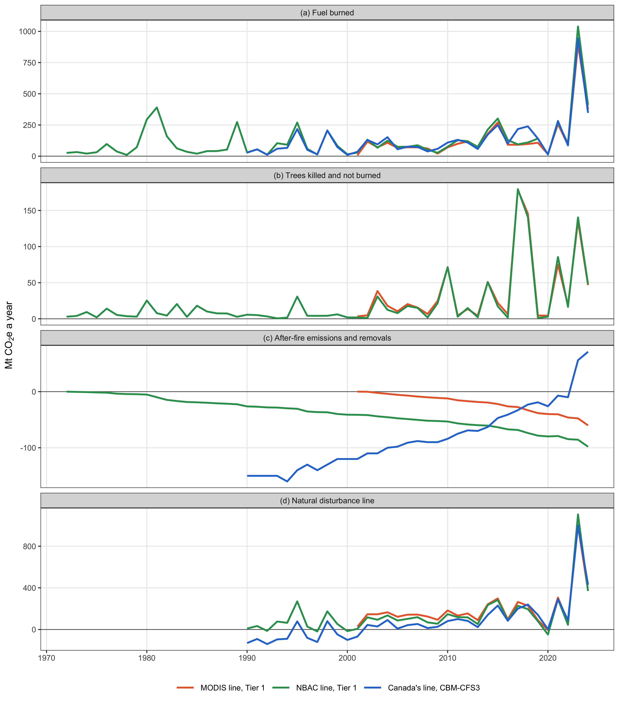

# Net emissions and removals from Canada's managed forestland with and without the disaggregation of natural disturbances

## Abstract

From 2017 to 2024, Canada’s reported net emissions and removals fell below their 2012 to 2016 mean in most years, but only with natural disturbances disaggregated. No study found had measured the disaggregation’s effect on emission reductions, or the record length it needs. This study rebuilt Canada’s natural disturbance emissions with the Tier 1 method of the Intergovernmental Panel on Climate Change guidelines. Burned area came from Canada’s National Burned Area Composite, 1972 to 2024, and a global satellite product, 2001 to 2024. Four treatments of natural disturbance were compared on the two rebuilt lines and Canada’s own. The four were no disaggregation, Canada’s current disaggregation method, and the threshold methods of Australia’s inventory and the 2013 Kyoto Protocol Supplement. Both threshold methods excluded natural disturbance emissions in years over two standard deviations above the mean of a baseline of 13 to 45 years. The composite’s line followed Canada’s fire year emissions (Pearson correlation 0.994, p < 0.001) but removed less after the fire. A longer baseline excluded no more fire years under Australia’s method, because the early record held large fire years as well as quiet ones. In simulated fire histories under the Kyoto Protocol method, a baseline of 45 years instead of 13 halved the 90 per cent range of annual reductions. It fell from 111 to 58 million tonnes of carbon dioxide equivalent a year, with the expected reduction near zero. A longer burned area record therefore steadied the Kyoto Protocol method rather than excluding more wildfires.

*Fig. 1 The global default layers of the Tier 1 fire estimate beside the national datasets of the higher tiers, four maps on one scale in EPSG:3978. (a) The ecological zones of FAO 2010, the default stratification of the IPCC biomass consumption table (IPCC, 2006, pp. 2.45–2.46). (b) The fuel types of the Fire Behaviour Prediction System, 2026 release, grouped by fuel. (c) The IPCC default soil classes. (d) The peatland map of the Canadian Forest Service, bog and fen by canopy. Map lines delineate study areas and do not necessarily depict accepted national boundaries.*

*Table 1 Rows of the 2006 IPCC Guidelines for Canada’s vegetation, with biomass consumption as mean and standard error and the combustion factor as mean and standard deviation (IPCC, 2006, pp. 2.45–2.49). The emission factor row is the row of the IPCC emission factor table each vegetation type took (IPCC, 2006, p. 2.47). The organic soil rows are those of the 2013 Wetlands Supplement, as mean and 95 per cent interval (Hiraishi et al., 2014, pp. 2.40–2.41). The Supplement gave emission factors of 362 ± 41 g of carbon dioxide carbon and 9 ± 4 g of methane per kilogram. A blank is a value the table did not print.*

<table>
<thead>
<tr>
<th width="2000" align="left">Vegetation</th>
<th width="2000" align="left">Subcategory</th>
<th width="2000" align="left">Biomass consumption (t/ha)</th>
<th width="2000" align="left">Combustion factor</th>
<th width="2000" align="left">Emission factor row</th>
</tr>
</thead>
<tbody>
<tr><td align="left">Boreal forest</td><td align="left">Wildfire (general)</td><td align="left">52.8 ± 48.4</td><td align="left">0.40 ± 0.06</td><td align="left">Extra tropical forest</td></tr>
<tr><td align="left">Boreal forest</td><td align="left">Crown fire</td><td align="left">25.1 ± 7.9</td><td align="left">0.43 ± 0.21</td><td align="left">Extra tropical forest</td></tr>
<tr><td align="left">Boreal forest</td><td align="left">Surface fire</td><td align="left">21.6 ± 25.1</td><td align="left">0.15 ± 0.08</td><td align="left">Extra tropical forest</td></tr>
<tr><td align="left">Boreal forest</td><td align="left">Post logging slash burn</td><td align="left">69.6 ± 44.8</td><td align="left">0.33 ± 0.13</td><td align="left">Extra tropical forest</td></tr>
<tr><td align="left">Boreal forest</td><td align="left">Land clearing fire</td><td align="left">87.5 ± 35.0</td><td align="left">0.59</td><td align="left">Extra tropical forest</td></tr>
<tr><td align="left">Boreal forest</td><td align="left">All boreal forest</td><td align="left">41.0 ± 36.5</td><td align="left">0.34 ± 0.17</td><td align="left">Extra tropical forest</td></tr>
<tr><td align="left">Other temperate forests</td><td align="left">Wildfire</td><td align="left">19.8 ± 6.3</td><td align="left"></td><td align="left">Extra tropical forest</td></tr>
<tr><td align="left">Other temperate forests</td><td align="left">Post logging slash burn</td><td align="left">77.5 ± 65.0</td><td align="left">0.62 ± 0.12</td><td align="left">Extra tropical forest</td></tr>
<tr><td align="left">Other temperate forests</td><td align="left">Felled and burned (land clearing fire)</td><td align="left">48.4 ± 62.7</td><td align="left">0.51</td><td align="left">Extra tropical forest</td></tr>
<tr><td align="left">Other temperate forests</td><td align="left">All other temperate forests</td><td align="left">50.4 ± 53.7</td><td align="left">0.45 ± 0.16</td><td align="left">Extra tropical forest</td></tr>
<tr><td align="left">Shrublands</td><td align="left">Shrubland (general)</td><td align="left">26.7 ± 4.2</td><td align="left">0.95</td><td align="left">Savanna and grassland</td></tr>
<tr><td align="left">Shrublands</td><td align="left">All shrublands</td><td align="left">14.3 ± 9.0</td><td align="left">0.72 ± 0.25</td><td align="left">Savanna and grassland</td></tr>
<tr><td align="left">Savanna grasslands and pastures</td><td align="left">All savanna grasslands (early dry season burns)</td><td align="left">2.1</td><td align="left">0.74</td><td align="left">Savanna and grassland</td></tr>
<tr><td align="left">Savanna grasslands and pastures</td><td align="left">Grassland (mid or late dry season burns)</td><td align="left">4.1 ± 3.1</td><td align="left">0.77 ± 0.26</td><td align="left">Savanna and grassland</td></tr>
<tr><td align="left">Other vegetation types</td><td align="left">Peatland</td><td align="left">41.0 ± 1.4</td><td align="left"></td><td align="left"></td></tr>
<tr><td align="left">Other vegetation types</td><td align="left">Tundra</td><td align="left">10.0</td><td align="left"></td><td align="left">Savanna and grassland</td></tr>
<tr><td align="left">Organic soil, boreal and temperate</td><td align="left">Wildfire (undrained peat)</td><td align="left">66 (46 to 86)</td><td align="left">1</td><td align="left">Wetlands Supplement, boreal and temperate</td></tr>
<tr><td align="left">Organic soil, boreal and temperate</td><td align="left">Wildfire (drained peat)</td><td align="left">336 ± 4</td><td align="left">1</td><td align="left">Wetlands Supplement, boreal and temperate</td></tr>
</tbody>
</table>

*Table 2 The Tier 1 fire estimate for Canada by ecological zone from the national fire record, 2023, with each zone’s burned area averaged over 2001 to 2024. Biomass consumption and the emission factors were the zone’s rows of the Tier 1 defaults in Online Resource 1. The uncertainty was the Approach 1 half width of the 95 per cent interval for carbon dioxide, with no error on burned area. The last row was the estimate generated by the FAOSTAT algorithm.*

<table>
<thead>
<tr>
<th width="2000" align="left">Ecological zone</th>
<th width="2000" align="left">Burned 2001 to 2024 (kha a year)</th>
<th width="2000" align="left">Burned 2023 (kha)</th>
<th width="2000" align="left">Biomass consumption (t/ha)</th>
<th width="2000" align="left">CO2 (Mt)</th>
<th width="2000" align="left">CH4 (kt)</th>
<th width="2000" align="left">N2O (kt)</th>
<th width="2000" align="left">CO2e (Mt)</th>
<th width="2000" align="left">Uncertainty (%)</th>
</tr>
</thead>
<tbody>
<tr><td align="left">Boreal tundra woodland</td><td align="left">1355</td><td align="left">10967</td><td align="left">52.8</td><td align="left">908.6</td><td align="left">2722</td><td align="left">150.6</td><td align="left">1024.7</td><td align="left">180</td></tr>
<tr><td align="left">Boreal coniferous forest</td><td align="left">1226</td><td align="left">4912</td><td align="left">52.8</td><td align="left">407.0</td><td align="left">1219</td><td align="left">67.4</td><td align="left">459.0</td><td align="left">180</td></tr>
<tr><td align="left">Temperate mountain system</td><td align="left">199</td><td align="left">744</td><td align="left">19.8</td><td align="left">23.1</td><td align="left">69</td><td align="left">3.8</td><td align="left">26.0</td><td align="left">64</td></tr>
<tr><td align="left">Boreal mountain system</td><td align="left">249</td><td align="left">634</td><td align="left">52.8</td><td align="left">52.5</td><td align="left">157</td><td align="left">8.7</td><td align="left">59.2</td><td align="left">180</td></tr>
<tr><td align="left">Temperate desert</td><td align="left">46</td><td align="left">179</td><td align="left">4.1</td><td align="left">1.2</td><td align="left">2</td><td align="left">0.2</td><td align="left">1.3</td><td align="left">149</td></tr>
<tr><td align="left">Temperate continental forest</td><td align="left">25</td><td align="left">81</td><td align="left">19.8</td><td align="left">2.5</td><td align="left">8</td><td align="left">0.4</td><td align="left">2.8</td><td align="left">64</td></tr>
<tr><td align="left">Polar</td><td align="left">6</td><td align="left">68</td><td align="left">10.0</td><td align="left">1.1</td><td align="left">2</td><td align="left">0.1</td><td align="left">1.2</td><td align="left"></td></tr>
<tr><td align="left">Temperate steppe</td><td align="left">5</td><td align="left">15</td><td align="left">4.1</td><td align="left">0.1</td><td align="left">0</td><td align="left">0.0</td><td align="left">0.1</td><td align="left">149</td></tr>
<tr><td align="left">Temperate oceanic forest</td><td align="left">0</td><td align="left">4</td><td align="left">19.8</td><td align="left">0.1</td><td align="left">0</td><td align="left">0.0</td><td align="left">0.1</td><td align="left">64</td></tr>
<tr><td align="left">All zones</td><td align="left">3112</td><td align="left">17604</td><td align="left">50.5</td><td align="left">1396.2</td><td align="left">4179</td><td align="left">231.3</td><td align="left">1574.5</td><td align="left">177</td></tr>
<tr><td align="left">FAOSTAT, other forest, one coefficient</td><td align="left">340</td><td align="left">2750</td><td align="left">42.2</td><td align="left">187.0</td><td align="left">267</td><td align="left">24.3</td><td align="left">200.9</td><td align="left">175</td></tr>
</tbody>
</table>

*Table 3 The Tier 1 fire estimate for 2023 by stratum, for Canada and for British Columbia (BC), from the fire points. Each fire took the row of Table 1 for its ecological zone and fire type. Every fire on organic soil also took the undrained peat row of the Wetlands Supplement as a second term. Ignition, fire type and month are the record’s own fields; the soil class and the land cover are the raster values at the fire’s location.*

<table>
<thead>
<tr>
<th width="2000" align="left">Stratum</th>
<th width="2000" align="left">Class</th>
<th width="2000" align="left">Canada burned (kha)</th>
<th width="2000" align="left">Canada vegetation CO2e (Mt)</th>
<th width="2000" align="left">Canada organic soil CO2e (Mt)</th>
<th width="2000" align="left">BC burned (kha)</th>
<th width="2000" align="left">BC vegetation CO2e (Mt)</th>
<th width="2000" align="left">BC organic soil CO2e (Mt)</th>
</tr>
</thead>
<tbody>
<tr><td align="left">Ignition</td><td align="left">Natural</td><td align="left">16220</td><td align="left">1372.2</td><td align="left">457.4</td><td align="left">2758</td><td align="left">203.0</td><td align="left">103.6</td></tr>
<tr><td align="left"></td><td align="left">Unknown</td><td align="left">888</td><td align="left">56.5</td><td align="left">32.2</td><td align="left">93</td><td align="left">6.5</td><td align="left">0.2</td></tr>
<tr><td align="left"></td><td align="left">Human</td><td align="left">496</td><td align="left">39.9</td><td align="left">0.5</td><td align="left">49</td><td align="left">3.8</td><td align="left">0.0</td></tr>
<tr><td align="left">Fire type</td><td align="left">Unspecified</td><td align="left">15523</td><td align="left">1380.0</td><td align="left">403.4</td><td align="left">2899</td><td align="left">213.2</td><td align="left">103.8</td></tr>
<tr><td align="left"></td><td align="left">Surface</td><td align="left">1028</td><td align="left">39.3</td><td align="left">52.7</td><td align="left">0</td><td align="left">0.0</td><td align="left">0.0</td></tr>
<tr><td align="left"></td><td align="left">Crown</td><td align="left">1000</td><td align="left">44.4</td><td align="left">33.0</td><td align="left">0</td><td align="left">0.0</td><td align="left">0.0</td></tr>
<tr><td align="left"></td><td align="left">Ground</td><td align="left">53</td><td align="left">5.0</td><td align="left">1.1</td><td align="left">0</td><td align="left">0.0</td><td align="left">0.0</td></tr>
<tr><td align="left"></td><td align="left">Prescribed</td><td align="left">0</td><td align="left">0.0</td><td align="left">0.0</td><td align="left">0</td><td align="left">0.0</td><td align="left">0.0</td></tr>
<tr><td align="left">Month</td><td align="left">April to May</td><td align="left">6545</td><td align="left">529.9</td><td align="left">195.4</td><td align="left">1040</td><td align="left">96.6</td><td align="left">30.2</td></tr>
<tr><td align="left"></td><td align="left">July</td><td align="left">5016</td><td align="left">414.7</td><td align="left">166.4</td><td align="left">1086</td><td align="left">61.7</td><td align="left">35.9</td></tr>
<tr><td align="left"></td><td align="left">June</td><td align="left">4793</td><td align="left">412.6</td><td align="left">67.5</td><td align="left">631</td><td align="left">45.5</td><td align="left">30.2</td></tr>
<tr><td align="left"></td><td align="left">August to October</td><td align="left">1248</td><td align="left">111.2</td><td align="left">60.8</td><td align="left">142</td><td align="left">9.3</td><td align="left">7.5</td></tr>
<tr><td align="left"></td><td align="left">Other months</td><td align="left">2</td><td align="left">0.2</td><td align="left">0.1</td><td align="left">0</td><td align="left">0.0</td><td align="left">0.0</td></tr>
<tr><td align="left">Soil class</td><td align="left">Mineral</td><td align="left">12496</td><td align="left">1035.3</td><td align="left">0.0</td><td align="left">1895</td><td align="left">119.6</td><td align="left">0.0</td></tr>
<tr><td align="left"></td><td align="left">Organic</td><td align="left">4702</td><td align="left">395.9</td><td align="left">490.1</td><td align="left">996</td><td align="left">93.0</td><td align="left">103.8</td></tr>
<tr><td align="left"></td><td align="left">Other</td><td align="left">406</td><td align="left">37.5</td><td align="left">0.0</td><td align="left">9</td><td align="left">0.6</td><td align="left">0.0</td></tr>
<tr><td align="left">Land cover</td><td align="left">Woody savanna, IGBP 8</td><td align="left">8605</td><td align="left">688.0</td><td align="left">330.3</td><td align="left">1367</td><td align="left">99.0</td><td align="left">77.8</td></tr>
<tr><td align="left"></td><td align="left">Savanna, IGBP 9</td><td align="left">5241</td><td align="left">487.6</td><td align="left">117.3</td><td align="left">1</td><td align="left">0.1</td><td align="left">0.0</td></tr>
<tr><td align="left"></td><td align="left">Forest, IGBP 1 to 5</td><td align="left">2704</td><td align="left">205.4</td><td align="left">42.2</td><td align="left">1458</td><td align="left">112.9</td><td align="left">26.0</td></tr>
<tr><td align="left"></td><td align="left">Shrubland, IGBP 6 to 7</td><td align="left">506</td><td align="left">43.5</td><td align="left">0.1</td><td align="left">0</td><td align="left">0.0</td><td align="left">0.0</td></tr>
<tr><td align="left"></td><td align="left">Other</td><td align="left">334</td><td align="left">29.6</td><td align="left">0.0</td><td align="left">8</td><td align="left">0.5</td><td align="left">0.0</td></tr>
<tr><td align="left"></td><td align="left">Wetland, IGBP 11</td><td align="left">140</td><td align="left">13.1</td><td align="left">0.2</td><td align="left">0</td><td align="left">0.0</td><td align="left">0.0</td></tr>
<tr><td align="left"></td><td align="left">Grassland, IGBP 10</td><td align="left">73</td><td align="left">1.5</td><td align="left">0.0</td><td align="left">65</td><td align="left">0.8</td><td align="left">0.0</td></tr>
<tr><td align="left">All fires</td><td align="left"></td><td align="left">17604</td><td align="left">1468.6</td><td align="left">490.1</td><td align="left">2899</td><td align="left">213.2</td><td align="left">103.8</td></tr>
</tbody>
</table>

*Fig. 2 Net emissions of the land use sector for Canada and British Columbia, 1990 to 2024, by inventory category, with the natural disturbance line that the reported total left out. The lines give the disaggregated account, the total Canada reported, and the undisaggregated account, that total plus the natural disturbance line. In Canada, Wetlands, at 5.4 to 10.0 Mt CO2e a year, and Settlements, at 3.7 to 6.3 Mt, were too small to show at this scale.*

*Table 4 Net emissions, five-year mean and reduction for Canada’s managed land under three accounts, 2017 to 2024. The five-year mean was that of 2012 to 2016, and the reduction was the mean minus the year’s net emissions. The threshold account left out the natural disturbance line only in years its 13 year baseline classed as natural.*

<table>
<thead>
<tr>
<th width="2000" align="left">Year</th>
<th width="2000" align="left">Account</th>
<th width="2000" align="left">Net emissions (Mt CO2e)</th>
<th width="2000" align="left">Five-year mean (Mt CO2e)</th>
<th width="2000" align="left">Reduction (Mt CO2e)</th>
</tr>
</thead>
<tbody>
<tr><td align="left">2017</td><td align="left">Disaggregated</td><td align="left">19.0</td><td align="left">25.7</td><td align="left">6.7</td></tr>
<tr><td align="left">2017</td><td align="left">Undisaggregated</td><td align="left">219.0</td><td align="left">137.7</td><td align="left">-81.3</td></tr>
<tr><td align="left">2017</td><td align="left">Threshold</td><td align="left">219.0</td><td align="left">91.7</td><td align="left">-127.3</td></tr>
<tr><td align="left">2018</td><td align="left">Disaggregated</td><td align="left">24.0</td><td align="left">25.7</td><td align="left">1.7</td></tr>
<tr><td align="left">2018</td><td align="left">Undisaggregated</td><td align="left">264.0</td><td align="left">137.7</td><td align="left">-126.3</td></tr>
<tr><td align="left">2018</td><td align="left">Threshold</td><td align="left">24.0</td><td align="left">91.7</td><td align="left">67.7</td></tr>
<tr><td align="left">2019</td><td align="left">Disaggregated</td><td align="left">16.0</td><td align="left">25.7</td><td align="left">9.7</td></tr>
<tr><td align="left">2019</td><td align="left">Undisaggregated</td><td align="left">156.0</td><td align="left">137.7</td><td align="left">-18.3</td></tr>
<tr><td align="left">2019</td><td align="left">Threshold</td><td align="left">156.0</td><td align="left">91.7</td><td align="left">-64.3</td></tr>
<tr><td align="left">2020</td><td align="left">Disaggregated</td><td align="left">26.0</td><td align="left">25.7</td><td align="left">-0.3</td></tr>
<tr><td align="left">2020</td><td align="left">Undisaggregated</td><td align="left">28.7</td><td align="left">137.7</td><td align="left">109.0</td></tr>
<tr><td align="left">2020</td><td align="left">Threshold</td><td align="left">28.7</td><td align="left">91.7</td><td align="left">63.0</td></tr>
<tr><td align="left">2021</td><td align="left">Disaggregated</td><td align="left">14.0</td><td align="left">25.7</td><td align="left">11.7</td></tr>
<tr><td align="left">2021</td><td align="left">Undisaggregated</td><td align="left">304.0</td><td align="left">137.7</td><td align="left">-166.3</td></tr>
<tr><td align="left">2021</td><td align="left">Threshold</td><td align="left">14.0</td><td align="left">91.7</td><td align="left">77.7</td></tr>
<tr><td align="left">2022</td><td align="left">Disaggregated</td><td align="left">46.0</td><td align="left">25.7</td><td align="left">-20.3</td></tr>
<tr><td align="left">2022</td><td align="left">Undisaggregated</td><td align="left">135.0</td><td align="left">137.7</td><td align="left">2.7</td></tr>
<tr><td align="left">2022</td><td align="left">Threshold</td><td align="left">135.0</td><td align="left">91.7</td><td align="left">-43.3</td></tr>
<tr><td align="left">2023</td><td align="left">Disaggregated</td><td align="left">-8.7</td><td align="left">25.7</td><td align="left">34.4</td></tr>
<tr><td align="left">2023</td><td align="left">Undisaggregated</td><td align="left">991.3</td><td align="left">137.7</td><td align="left">-853.6</td></tr>
<tr><td align="left">2023</td><td align="left">Threshold</td><td align="left">-8.7</td><td align="left">91.7</td><td align="left">100.4</td></tr>
<tr><td align="left">2024</td><td align="left">Disaggregated</td><td align="left">4.3</td><td align="left">25.7</td><td align="left">21.4</td></tr>
<tr><td align="left">2024</td><td align="left">Undisaggregated</td><td align="left">434.3</td><td align="left">137.7</td><td align="left">-296.6</td></tr>
<tr><td align="left">2024</td><td align="left">Threshold</td><td align="left">4.3</td><td align="left">91.7</td><td align="left">87.4</td></tr>
</tbody>
</table>

*Fig. 3 Canada’s natural disturbance line and the lines rebuilt with the IPCC Tier 1 method on two burned area records, MCD64A1 for 2001 to 2024 and the National Burned Area Composite for 1972 to 2024. (a) Fuel burned, by Equations 2.27 and 2.8, and Canada’s immediate wildfire emissions. (b) Trees killed and not burned, by Equation 2.14, which Canada’s model moved to dead organic matter. (c) After-fire emissions and removals, which in the Tier 1 lines were regrowth alone. (d) The natural disturbance line, each line with Canada’s insect and other disturbances. Canada’s values came from CBM-CFS3 (ECCC, 2026, p. 203).*

*Table 5 Emission reductions under four treatments of the natural disturbance line on three lines, and the annual reductions that natural disturbance alone produced in simulated histories with management fixed. The MODIS and NBAC lines were rebuilt with the IPCC Tier 1 method on MCD64A1 and the National Burned Area Composite, and Canada’s line came from CBM-CFS3. Positive reductions summed the positive differences between each account’s 2012 to 2016 mean and its emissions of 2017 to 2024. The mean and standard deviation were those of the simulated annual reductions, and the half width was half the range from their 5th to 95th percentile. The simulated threshold rule tested burned area, so the rows testing fire emissions and the line had no simulated values. Online Resource 7 gave every baseline from 13 years.*

<table>
<thead>
<tr>
<th width="2000" align="left">Treatment</th>
<th width="2000" align="left">Test series</th>
<th width="2000" align="left">Baseline (years)</th>
<th width="2000" align="left">MODIS, positive (Mt CO2e)</th>
<th width="2000" align="left">MODIS, mean ± SD (Mt CO2e a year)</th>
<th width="2000" align="left">MODIS, 90% half width (Mt CO2e a year)</th>
<th width="2000" align="left">NBAC, positive (Mt CO2e)</th>
<th width="2000" align="left">NBAC, mean ± SD (Mt CO2e a year)</th>
<th width="2000" align="left">NBAC, 90% half width (Mt CO2e a year)</th>
<th width="2000" align="left">Canada, positive (Mt CO2e)</th>
<th width="2000" align="left">Canada, mean ± SD (Mt CO2e a year)</th>
<th width="2000" align="left">Canada, 90% half width (Mt CO2e a year)</th>
</tr>
</thead>
<tbody>
<tr><td align="left">No disaggregation</td><td align="left"></td><td align="left"></td><td align="left">357.9</td><td align="left">−76.5 ± 186.1</td><td align="left">281</td><td align="left">377.5</td><td align="left">−42.1 ± 260.6</td><td align="left">469</td><td align="left">111.7</td><td align="left">−77.9 ± 222.0</td><td align="left">395</td></tr>
<tr><td align="left">Canada's approach</td><td align="left"></td><td align="left"></td><td align="left">85.6</td><td align="left">0.0 ± 0.0</td><td align="left">0</td><td align="left">85.6</td><td align="left">0.0 ± 0.0</td><td align="left">0</td><td align="left">85.6</td><td align="left">0.0 ± 0.0</td><td align="left">0</td></tr>
<tr><td align="left">Threshold rule</td><td align="left">Fire emissions</td><td align="left">13</td><td align="left">720.0</td><td align="left"></td><td align="left"></td><td align="left">570.8</td><td align="left"></td><td align="left"></td><td align="left">396.2</td><td align="left"></td><td align="left"></td></tr>
<tr><td align="left">Threshold rule</td><td align="left">Fire emissions</td><td align="left">16</td><td align="left">720.0</td><td align="left"></td><td align="left"></td><td align="left">676.1</td><td align="left"></td><td align="left"></td><td align="left">468.9</td><td align="left"></td><td align="left"></td></tr>
<tr><td align="left">Threshold rule</td><td align="left">Fire emissions</td><td align="left">27</td><td align="left"></td><td align="left"></td><td align="left"></td><td align="left">676.1</td><td align="left"></td><td align="left"></td><td align="left">396.2</td><td align="left"></td><td align="left"></td></tr>
<tr><td align="left">Threshold rule</td><td align="left">Fire emissions</td><td align="left">45</td><td align="left"></td><td align="left"></td><td align="left"></td><td align="left">570.8</td><td align="left"></td><td align="left"></td><td align="left"></td><td align="left"></td><td align="left"></td></tr>
<tr><td align="left">Threshold rule</td><td align="left">Natural disturbance line</td><td align="left">13</td><td align="left">596.6</td><td align="left"></td><td align="left"></td><td align="left">570.8</td><td align="left"></td><td align="left"></td><td align="left">468.9</td><td align="left"></td><td align="left"></td></tr>
<tr><td align="left">Threshold rule</td><td align="left">Natural disturbance line</td><td align="left">16</td><td align="left">596.6</td><td align="left"></td><td align="left"></td><td align="left">570.8</td><td align="left"></td><td align="left"></td><td align="left">468.9</td><td align="left"></td><td align="left"></td></tr>
<tr><td align="left">Threshold rule</td><td align="left">Natural disturbance line</td><td align="left">27</td><td align="left"></td><td align="left"></td><td align="left"></td><td align="left">570.8</td><td align="left"></td><td align="left"></td><td align="left">468.9</td><td align="left"></td><td align="left"></td></tr>
<tr><td align="left">Threshold rule</td><td align="left">Burned area</td><td align="left">13</td><td align="left">596.6</td><td align="left">25.3 ± 116.0</td><td align="left">178</td><td align="left">570.8</td><td align="left">−5.2 ± 124.9</td><td align="left">201</td><td align="left">328.5</td><td align="left">−40.8 ± 115.6</td><td align="left">186</td></tr>
<tr><td align="left">Threshold rule</td><td align="left">Burned area</td><td align="left">16</td><td align="left">596.6</td><td align="left">29.3 ± 112.4</td><td align="left">172</td><td align="left">570.8</td><td align="left">−8.8 ± 121.8</td><td align="left">198</td><td align="left">328.5</td><td align="left">−44.0 ± 113.2</td><td align="left">185</td></tr>
<tr><td align="left">Threshold rule</td><td align="left">Burned area</td><td align="left">27</td><td align="left"></td><td align="left"></td><td align="left"></td><td align="left">570.8</td><td align="left">−11.5 ± 115.0</td><td align="left">189</td><td align="left">328.5</td><td align="left">−46.2 ± 108.0</td><td align="left">179</td></tr>
<tr><td align="left">Threshold rule</td><td align="left">Burned area</td><td align="left">45</td><td align="left"></td><td align="left"></td><td align="left"></td><td align="left">570.8</td><td align="left">−10.4 ± 104.5</td><td align="left">170</td><td align="left">328.5</td><td align="left">−44.2 ± 100.8</td><td align="left">165</td></tr>
<tr><td align="left">Background level</td><td align="left">Natural disturbance line</td><td align="left">13</td><td align="left">227.3</td><td align="left">5.2 ± 61.8</td><td align="left">109</td><td align="left">229.4</td><td align="left">7.7 ± 73.5</td><td align="left">114</td><td align="left">232.8</td><td align="left">−3.0 ± 59.8</td><td align="left">89</td></tr>
<tr><td align="left">Background level</td><td align="left">Natural disturbance line</td><td align="left">16</td><td align="left">230.4</td><td align="left">6.8 ± 56.9</td><td align="left">101</td><td align="left">235.3</td><td align="left">4.2 ± 62.0</td><td align="left">99</td><td align="left">278.9</td><td align="left">−0.4 ± 55.6</td><td align="left">84</td></tr>
<tr><td align="left">Background level</td><td align="left">Natural disturbance line</td><td align="left">27</td><td align="left"></td><td align="left"></td><td align="left"></td><td align="left">273.1</td><td align="left">1.8 ± 46.5</td><td align="left">79</td><td align="left">466.5</td><td align="left">13.2 ± 62.0</td><td align="left">96</td></tr>
<tr><td align="left">Background level</td><td align="left">Burned area</td><td align="left">13</td><td align="left">255.2</td><td align="left">24.1 ± 55.7</td><td align="left">97</td><td align="left">217.1</td><td align="left">5.7 ± 72.6</td><td align="left">111</td><td align="left">68.4</td><td align="left">−27.5 ± 66.7</td><td align="left">104</td></tr>
<tr><td align="left">Background level</td><td align="left">Burned area</td><td align="left">16</td><td align="left">257.4</td><td align="left">27.6 ± 50.3</td><td align="left">87</td><td align="left">220.1</td><td align="left">2.2 ± 60.4</td><td align="left">97</td><td align="left">70.0</td><td align="left">−29.3 ± 57.8</td><td align="left">92</td></tr>
<tr><td align="left">Background level</td><td align="left">Burned area</td><td align="left">27</td><td align="left"></td><td align="left"></td><td align="left"></td><td align="left">231.2</td><td align="left">−0.5 ± 44.4</td><td align="left">77</td><td align="left">76.0</td><td align="left">−28.3 ± 46.9</td><td align="left">77</td></tr>
<tr><td align="left">Background level</td><td align="left">Burned area</td><td align="left">45</td><td align="left"></td><td align="left"></td><td align="left"></td><td align="left">240.2</td><td align="left">1.1 ± 33.8</td><td align="left">58</td><td align="left">80.9</td><td align="left">−21.8 ± 38.9</td><td align="left">64</td></tr>
</tbody>
</table>
